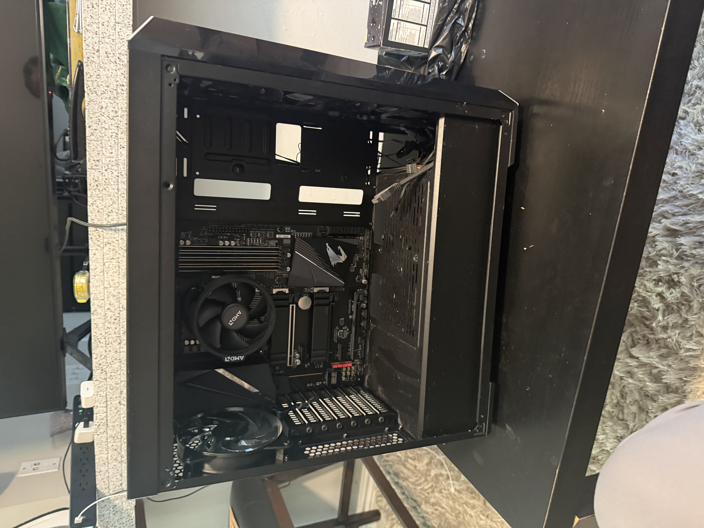

# PC Hardware Deployment Lab

Hands-on lab documenting a custom PC build, front-fan power and RGB wiring, memory troubleshooting, and BIOS hardware checks. The project develops practical hardware support skills relevant to data center technician work.

**Current milestone: hardware assembly and BIOS checks completed. Operating system installation is NOT completed. Neither Rocky Linux nor Windows has been installed as part of this lab.**

Documentation updated: November 10, 2026. This is the documentation date; individual assembly and troubleshooting dates were not retained.

## Progress

| Work item | Status | Recorded outcome |
| --- | --- | --- |
| PC assembly | Completed | Motherboard, CPU, RAM, NVMe SSD, GPU, and power connections installed |
| Front-fan power and RGB wiring | Completed in the lab record | Photos show three front fans and loose wiring; final power and lighting paths still need clear photos |
| DRAM diagnostic LED troubleshooting | Resolved in the lab record | RAM reseated; display output restored and BIOS reached |
| BIOS hardware detection | Completed | Processor, installed memory, and NVMe storage detected |
| AMD CPU fTPM | Enabled in BIOS | Firmware setting enabled; OS-level TPM validation is pending |
| Rocky Linux installation | **NOT COMPLETED** | Desktop edition selected as the intended next phase |
| Windows installation | **NOT COMPLETED** | Earlier Windows deployment wording did not reflect completed work |
| Drivers and post-installation validation | **NOT COMPLETED** | No OS-based device, network, update, or performance results recorded |

Completion entries reflect the owner's lab report and retained notes from **Learn Computer Repair**. Twelve reviewed photos now document assembly stages, PSU cable identification, front-fan/case wiring, and a boot-device prompt. The early interior photos show empty RAM and expansion slots; the boot-device prompt shows display output but does not establish an OS installation. Hardware specifications below remain retained lab notes. See the [evidence register](docs/evidence.md) for photographed states and reported outcomes.

## Recorded hardware

| Component | Specification from the retained lab notes |
| --- | --- |
| Motherboard | Gigabyte B550 AORUS PRO AC |
| Processor | AMD Ryzen 5 3600 |
| Memory | 16 GB DDR4 |
| Storage | Inland TN320 256 GB NVMe SSD |
| Graphics | NVIDIA GeForce GT 1030 |
| Firmware | UEFI BIOS; AMD CPU fTPM enabled |

Case and power-supply models, RAM kit details, motherboard revision, and BIOS version remain unconfirmed. A mounted PSU is pictured, with an 80 PLUS Bronze marking visible on its label.

## Lab documentation

- [Assembly and front-fan wiring](docs/assembly-and-wiring.md) — installed components, fan power, RGB connections, and remaining connection details.
- [DRAM LED and display troubleshooting](docs/troubleshooting.md) — symptom, corrective action, observed result, and limits of the diagnosis.
- [BIOS hardware detection and AMD fTPM](docs/bios-validation.md) — completed firmware checks and pending validation.
- [Photo and evidence register](docs/evidence.md) — available sources and photographs still needed in the repository.
- [Assembly and boot photo gallery](docs/photo-gallery.md) — twelve reviewed photos with captions and original filename references.

## Assembly photo

Early assembly stage: motherboard and AMD-branded CPU cooler mounted in the case, with RAM and expansion slots still empty. The [full gallery](docs/photo-gallery.md) includes power cables, front-fan wiring, a mounted PSU, and the boot-device message.

## Skills practiced

- Installing and connecting PC hardware.
- Investigating a DRAM diagnostic LED and a missing display output.
- Reseating RAM and checking whether the system can reach BIOS.
- Identifying installed components in firmware and enabling AMD CPU fTPM.
- Recording completed work separately from planned deployment and testing.

## Next phase — operating system deployment

Rocky Linux with a desktop is the last recorded choice. Windows remains an alternative, with no installation completed for either system. The exact OS version and installer image have not been finalized in this documentation.

- [ ] Confirm the OS edition/version and obtain its official installation media.
- [ ] Prepare and verify a bootable USB installer.
- [ ] Record the final UEFI boot configuration and target disk; back up any needed disk contents before installation.
- [ ] Install the selected OS and capture installation evidence.
- [ ] Configure drivers, updates, networking, and user accounts.
- [ ] Perform and document memory, storage, temperature, and network checks.
- [ ] Add final-build, DRAM troubleshooting, and BIOS/fTPM photos, plus new validation results, to the evidence register.

Reaching BIOS establishes the current hardware milestone. Long-term stability, OS compatibility, and post-installation behavior still require testing.
