# Assembly and Boot Photo Gallery

[Back to the project overview](../README.md) · [Evidence register](evidence.md)

These twelve photos document assembly stages, cable identification, wiring inspection, and a boot-device prompt. They are grouped by subject and do not establish an exact sequence or completion date. The completed-build, DRAM troubleshooting, BIOS hardware-detection, and fTPM results remain based on the lab notes. **OS installation is NOT completed.**

## Front exterior — CASE-03

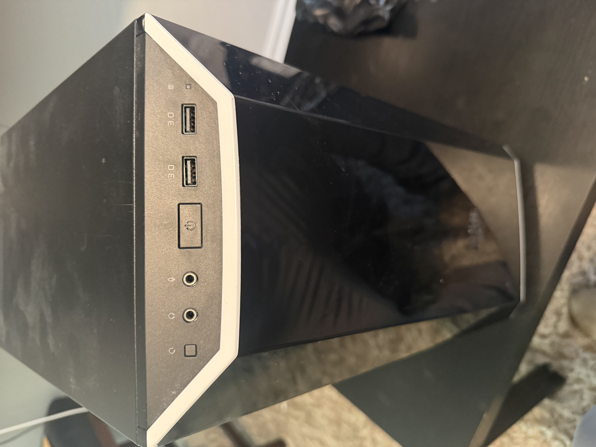

**Source: `IMG_8660.jpeg`.** The front of the case shows its buttons, audio jacks, and two USB ports marked `3.0`. The photo records the physical interface layout; it does not test port operation or internal connections.

## Motherboard and cooler installation — ASM-01 and ASM-03

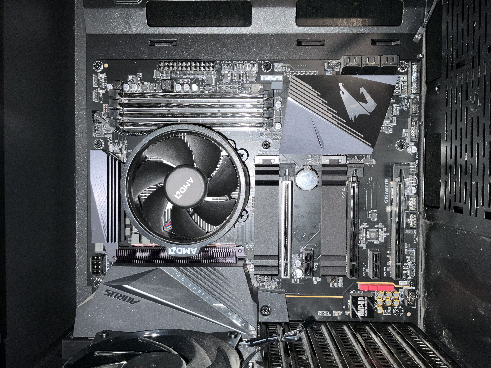

**Source: `IMG_0323.jpeg`.** The motherboard and an AMD-branded CPU cooler are mounted in the chassis. The four DIMM slots and visible PCIe expansion slots are empty. The cooler covers the CPU, so this photo does not establish the processor model.

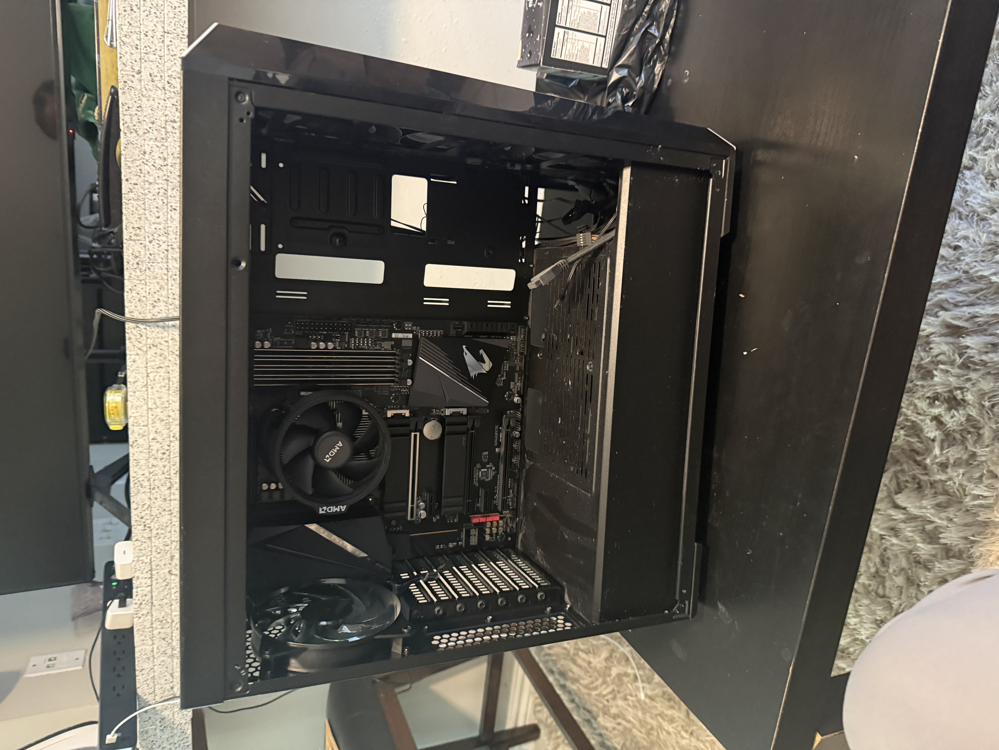

**Source: `IMG_8659.jpeg`.** A wider interior view shows the mounted board, AMD cooler, rear fan, and front-fan area. RAM and graphics-card installation and final wiring are not pictured in this early-stage view.

## Rear chassis and I/O — CASE-01 and CASE-02

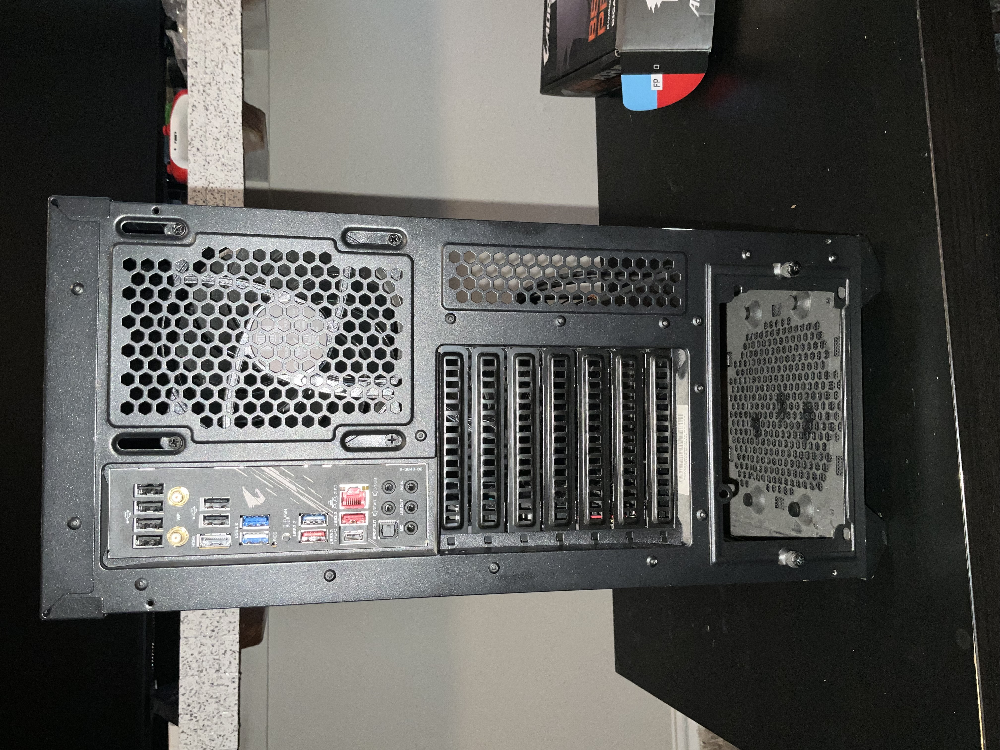

**Source: `IMG_0325.jpeg`.** Rear view with motherboard I/O, rear fan grille, and expansion-slot covers visible. The PSU bay is open and no graphics-card output bracket is present.

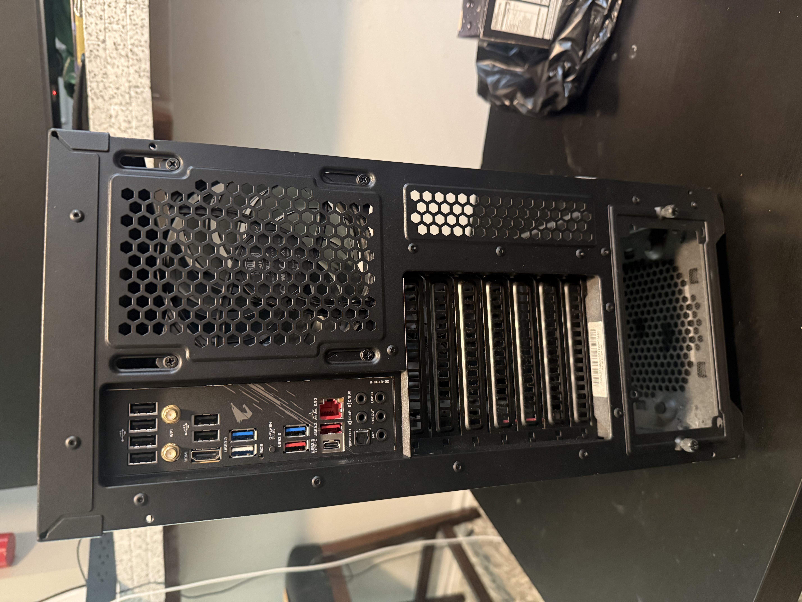

**Source: `IMG_8658.jpeg`.** A second rear view records the same early chassis state, including the open PSU bay and rear I/O layout. It does not show final PSU or GPU installation.

## PSU cable identification — PWR-01 and PWR-03

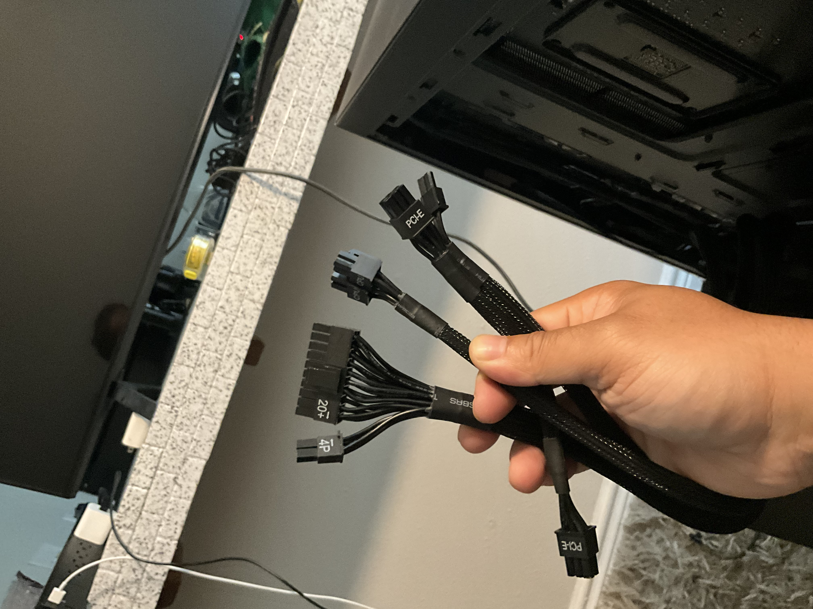

**Source: `IMG_0326.jpeg`.** Loose PSU cables are held up for identification. The main power connector is marked `20+4`; CPU and PCI-E labels are also visible. This records cable identification rather than final connections.

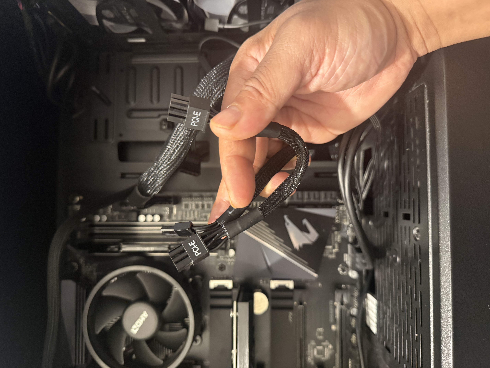

**Source: `IMG_8678.jpeg`.** Close-up of PCI-E-labelled PSU connectors. Their presence does not establish that a particular graphics card needs external power or that these leads were connected to it.

## Power installation in progress — ASM-02 and PWR-02

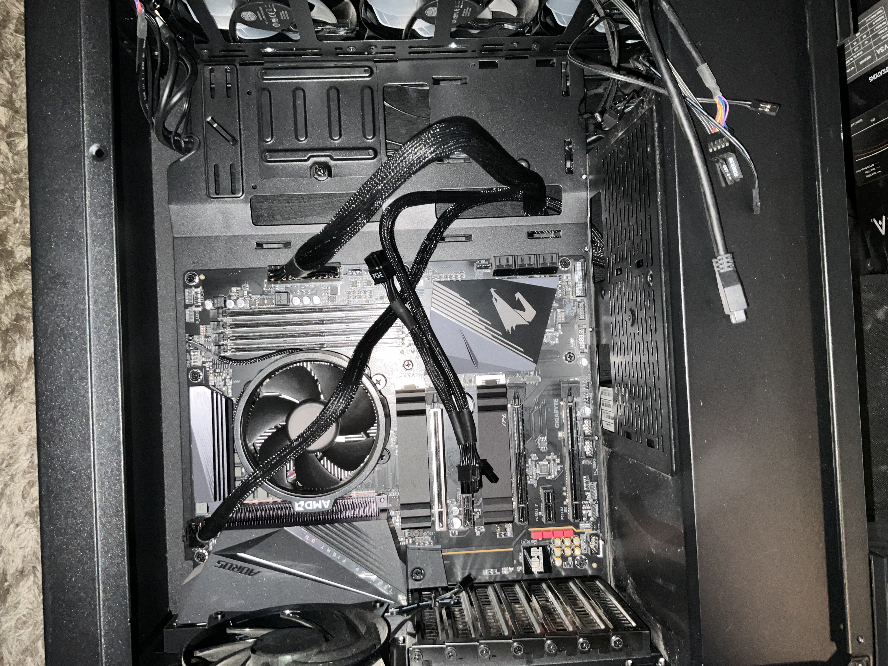

**Source: `IMG_0327.jpeg`.** The main ATX power connector is attached at the motherboard edge, with additional leads routed across the board. Some remain loose, and the RAM and expansion slots are empty. This is an intermediate wiring view.

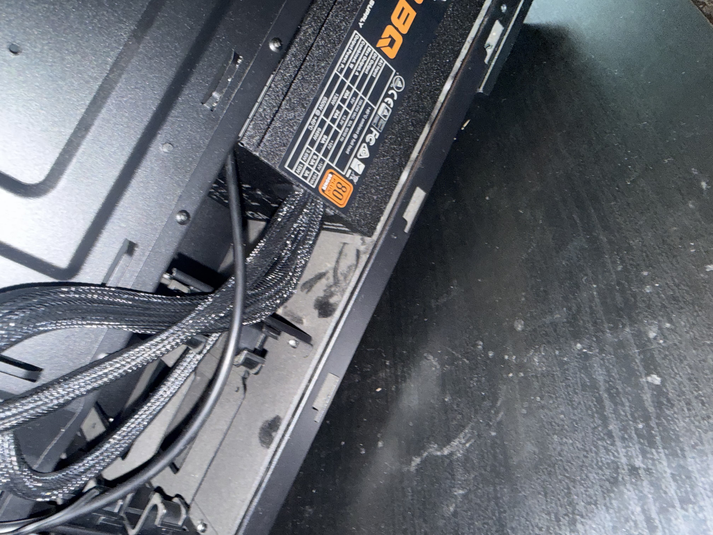

**Source: `IMG_8672.jpeg`.** The PSU is mounted in the lower compartment, with cables routed into the chassis. An 80 PLUS Bronze marking is visible on the label. Its full model designation and electrical operation are not established by this view.

## Front-fan wiring inspection — FAN-01 and FAN-02

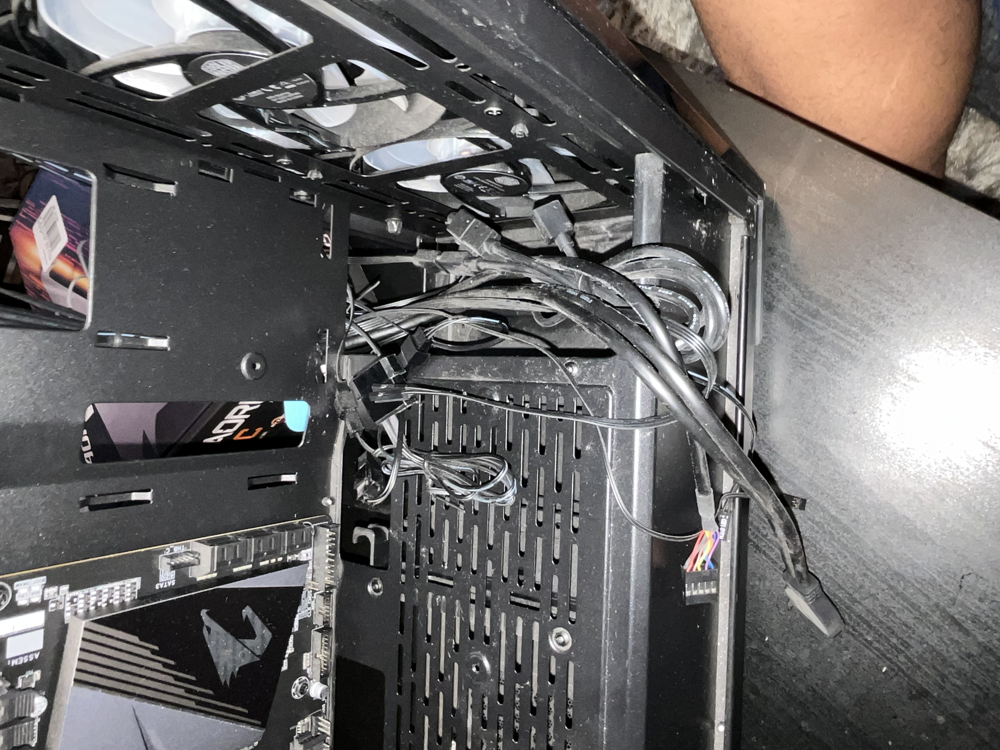

**Source: `IMG_0324.jpeg`.** Three front-mounted fans and loose case leads and connectors are visible. The photo documents the wiring area during inspection. A complete final fan power or lighting path and operating fan/lighting state are not shown.

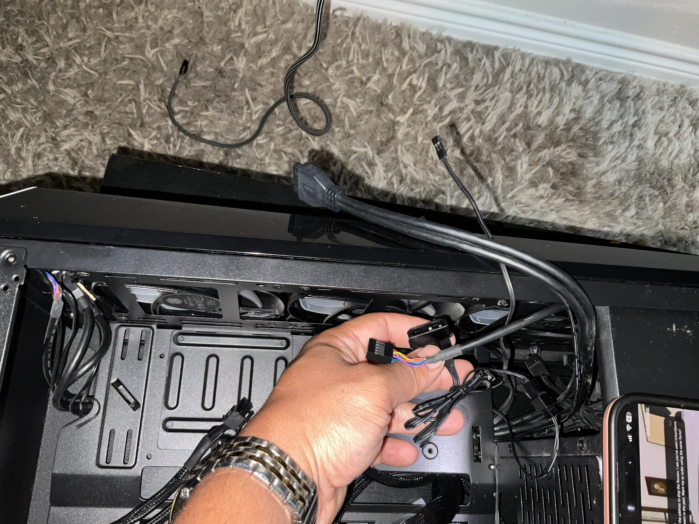

**Source: `IMG_0328.jpeg`.** Several loose case connectors are held near the front fans, including a multicolored-wire lead and a larger connector. These are not sufficient to identify an RGB pinout or a specific lighting controller. Final fan and lighting connections require a separate, traceable view.

## Boot-device message — BOOT-01

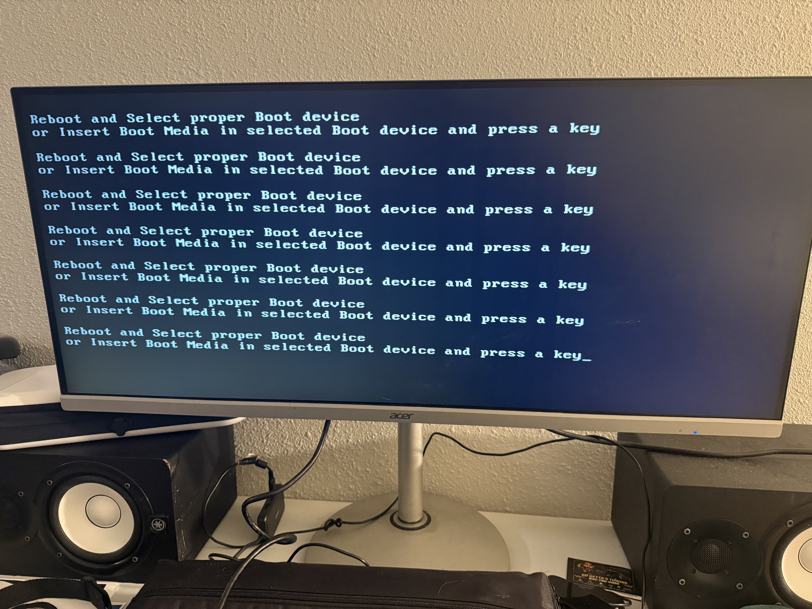

**Source: `IMG_8690.jpeg`.** The monitor displays **Reboot and Select proper Boot device**, followed by an instruction to insert boot media. This is visual evidence of display output at the boot stage and a failure to boot a usable target in that attempt. It is consistent with the owner's report that no OS has been installed. It does not prove SSD failure or confirm BIOS hardware detection or fTPM configuration.

## Remaining photographs

The [evidence register](evidence.md) lists the final-build overview, final fan power/lighting connections, DRAM diagnostic LED, installed memory after troubleshooting, and BIOS/fTPM screens still needed. Neither Rocky Linux nor Windows installation is claimed by these photos.
